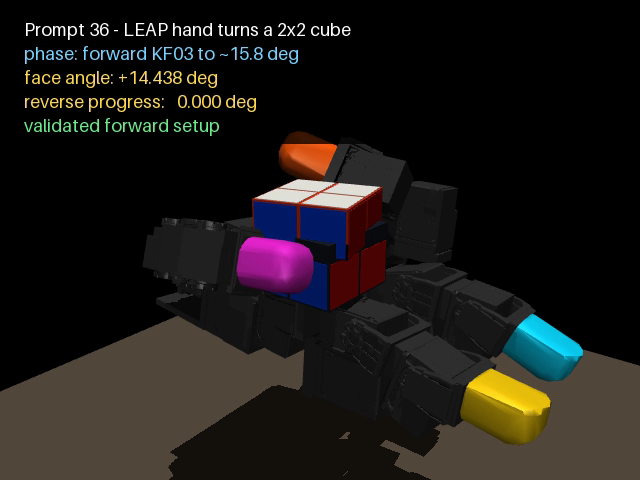
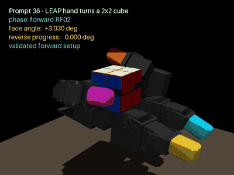

<div align="center">

# Contact-Driven Cube Face Turning with a LEAP Hand

Deterministic in-hand manipulation in MuJoCo using a 16-DoF LEAP Hand and a passive articulated 2×2 cube.

[](https://www.python.org/)
[](https://mujoco.org/)
[](https://github.com/sarahxugatech/leap-hand-cube-turn-mujoco/actions/workflows/validate.yml)
[](https://sarahxugatech.github.io/leap-hand-cube-turn-mujoco/)

[Live video demo](https://sarahxugatech.github.io/leap-hand-cube-turn-mujoco/) · [Technical report](docs/technical-report.md) · [Implementation log](docs/engineering/implementation-log.md)

</div>



## Overview

This project reproduces a dexterous manipulation task from scratch in desktop MuJoCo. A scripted controller establishes a stable grasp, lifts the cube, reaches the passive face layer, turns it through physical contact, and reverses it toward the starting angle.

The experiment deliberately excludes reinforcement learning, MPC, VLA, attachment constraints, and direct face-joint updates during execution. Every reported result comes from deterministic replay in this repository.

## Measured result

| Metric | Result |
|---|---:|
| Stable lift | 30 mm |
| Forward face turn | 15.766° |
| Reverse travel | 15.811° |
| Final face angle | −0.045° |
| Core-support rate | 98.75% |
| Independent replays | 2 identical passes |
| Penetration over 2 mm | None |
| Solver warnings | None |

The 90° objective is not yet complete. The present limit is a grasp-topology problem: near 15°, the pushing finger approaches its usable workspace, while transferring the load to another finger destabilizes the cube core.

## Controller and simulation modifications

- Replaced abrupt position commands with cosine-interpolated joint trajectories.
- Structured the controller into grasp, lift, reach, face-turn, hold, and reverse phases.
- Added deterministic joint-grid searches for contact-rich keyframes.
- Replaced a rigid cube with a simplified 2×2 model containing a passive rotating layer.
- Added repeatability, contact, object-drift, penetration, and solver-warning checks.

The rotating layer has no actuator. Its motion is generated only by simulated finger contact.

## Demonstration



[Watch the full browser-based demonstration](https://sarahxugatech.github.io/leap-hand-cube-turn-mujoco/)

## Reproduce the result

### 1. Install

```bash
git clone --recurse-submodules https://github.com/sarahxugatech/leap-hand-cube-turn-mujoco.git
cd leap-hand-cube-turn-mujoco
python3.12 -m venv .venv
.venv/bin/python -m pip install --only-binary=:all: -r requirements.txt
```

### 2. Validate

```bash
.venv/bin/python scripts/validate_2x2_hand_turn.py
```

Expected terminal result:

```text
repeatable=YES
HAND_CONTROLLED_2X2_TRAJECTORY=PASS
```

### 3. Render

```bash
.venv/bin/python scripts/render_2x2_hand_turn.py
```

The rendered MP4 is written to `videos/leap_hand_2x2_turn.mp4`.

## System design

```text
LEAP Hand model (MuJoCo Menagerie)
              |
              v
  grasp -> lift -> reach -> turn -> hold -> reverse
              |                  |
              v                  v
      cosine interpolation   passive face joint
              \                  /
               v                v
             deterministic validator
       contact | drift | penetration | warnings
```

## Repository guide

| Path | Purpose |
|---|---|
| `scenes/` | MuJoCo model and test scenes |
| `poses/` | Controller targets and validated keyframes |
| `scripts/` | Validation, rendering, search, and diagnostic tools |
| `logs/` | Machine-readable experiment evidence |
| `docs/` | Technical report, engineering history, and demo site |
| `docs/assets/` | Browser-ready demonstration media |
| `menagerie/` | Pinned MuJoCo Menagerie submodule |

Start with `scripts/validate_2x2_hand_turn.py`. The other search and diagnostic files document the experimental path to the current result; directory-level README files explain their organization.

## Scope and limitations

- Simulation only; no hardware transfer has been tested.
- One LEAP Hand and one cube face only.
- Scripted deterministic control; no learned policy.
- Current validated rotation is 15.766°, not the final 90° target.
- The full pre-cleanup development snapshot is preserved on the `research-archive-2026-10-30` branch.

## Attribution

The LEAP Hand model is provided through the [MuJoCo Menagerie](https://github.com/google-deepmind/mujoco_menagerie) submodule. Model licensing and attribution remain governed by the files in that upstream repository.

